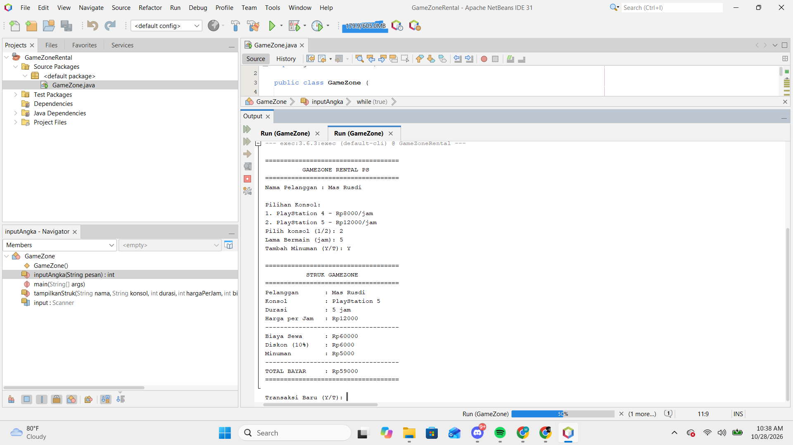
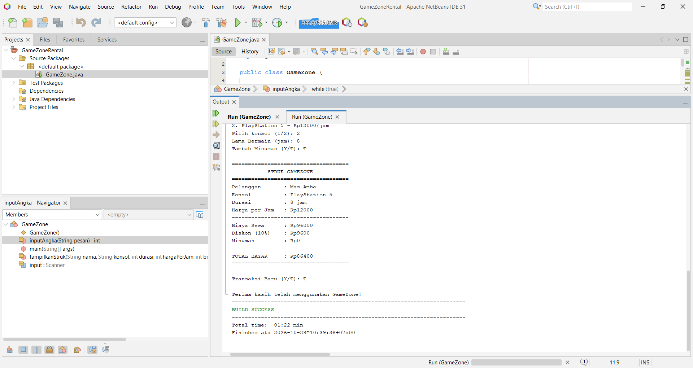

# GameZone Rental PS

Aplikasi console Java untuk menghitung biaya sewa PlayStation di GameZone.

## Deskripsi
Program menghitung biaya sewa PS4/PS5, diskon 10% untuk bermain minimal 3 jam,
tambahan minuman opsional, lalu menampilkan struk transaksi.

## Cara Menjalankan
1. Buka proyek dengan Apache NetBeans IDE.
2. Buka file GameZone.java.
3. Klik kanan file lalu pilih Run File (Shift + F6).
4. Ikuti instruksi input di jendela Output.

## Screenshot Output

