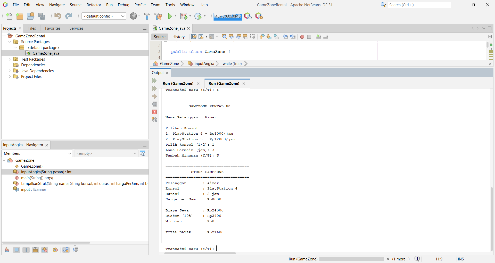

# 🎮 GameZone Rental PS

Halo! Ini tugas latihan praktikum Pemrograman Java Dasar aku, yaitu aplikasi console buat ngitung biaya sewa PlayStation di rental "GameZone".

- **Nama** : Muhamad Rizal Rivardi
- **NIM** : C2483207007
- **Kampus** : Pendidikan Teknologi Informasi, Universitas Muhammadiyah Tasikmalaya

---

## 📖 Tentang Program

Jadi ceritanya GameZone itu tempat rental PS4 dan PS5. Nah, program ini bantu petugas buat ngitung biaya sewa dan nampilin struk pembayaran pelanggan. Semuanya jalan di console, tanpa Swing dan tanpa database.

### Fitur-fiturnya

- Input nama pelanggan (gak boleh kosong).
- Pilih konsol:
  - PlayStation 4 : Rp8.000/jam
  - PlayStation 5 : Rp12.000/jam
- Input lama bermain dalam jam (harus bilangan bulat positif).
- **Diskon 10%** dari biaya sewa kalau main minimal **3 jam**.
- Bisa tambah minuman Rp5.000 (opsional).
- Nampilin struk lengkap: pelanggan, konsol, durasi, biaya sewa, diskon, minuman, dan total bayar.
- Setelah struk keluar, bisa langsung bikin transaksi baru atau akhiri program.

### Rumus hitungnya

```
Total Bayar = Biaya Sewa - Diskon + Biaya Minuman
```

Contoh: PS5, 4 jam, pakai minuman
`48.000 - 4.800 + 5.000 = 48.200`

---

## 🧰 Yang Dipakai

- Java
- Apache NetBeans IDE (Maven project)
- `Scanner` buat input
- Variabel, tipe data, dan operator aritmatika
- Percabangan `if-else`
- Perulangan `while` dan `do-while`
- Method buatan sendiri:
  - `inputAngka()` buat baca input angka sekaligus validasinya
  - `tampilkanStruk()` buat nampilin struk transaksi

---

## ▶️ Cara Menjalankan

1. Clone repositori ini atau download project-nya.
2. Buka project pakai **Apache NetBeans IDE**.
3. Buka file `src/main/java/GameZone.java`.
4. Klik kanan di file-nya, terus pilih **Run File** (atau tekan `Shift + F6`).
5. Ikuti instruksi yang muncul di jendela Output, tinggal isi nama, pilih konsol, masukin durasi, dan jawab Y/T.

---

## 📸 Screenshot Output

### Contoh transaksi


### Output tambahan



---

## 📁 Struktur Project

```
.
├── pom.xml
├── README.md
├── screenshots/
│   ├── output.png
│   ├── output2.png
│   ├── output3.png
│   ├── output4.png
│   └── output5.png
└── src/main/java/
    └── GameZone.java
```

---

## 📝 Catatan

Di program ini aku nambahin validasi input biar gak gampang error, misalnya:

- Durasi harus angka bulat lebih dari 0, kalau salah bakal diminta ulang.
- Pilihan konsol cuma boleh 1 atau 2.
- Jawaban minuman dan transaksi baru cuma boleh Y atau T.

Makasih udah mampir! 🙌
